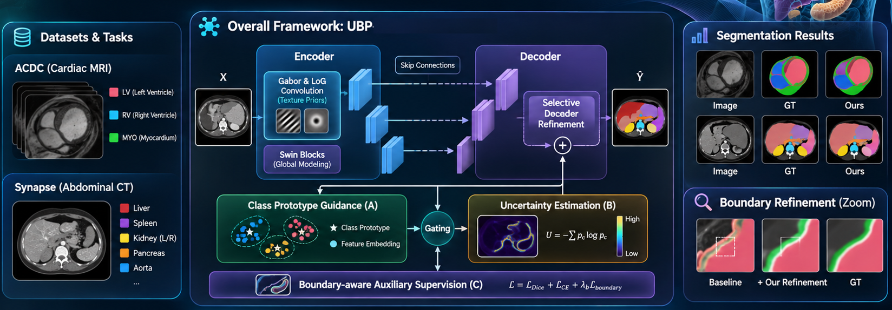
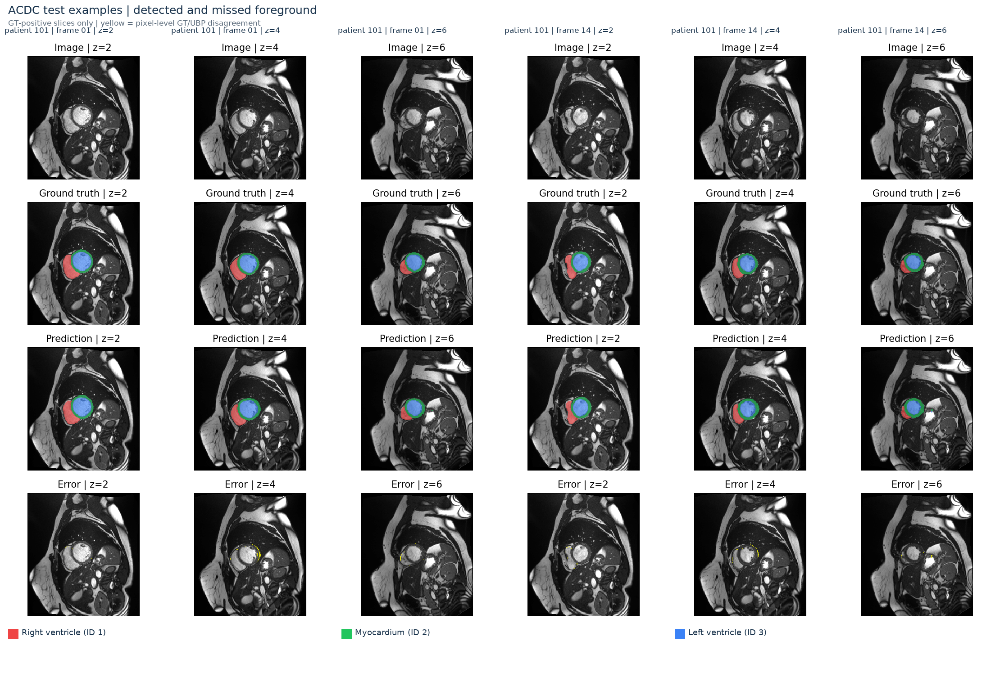
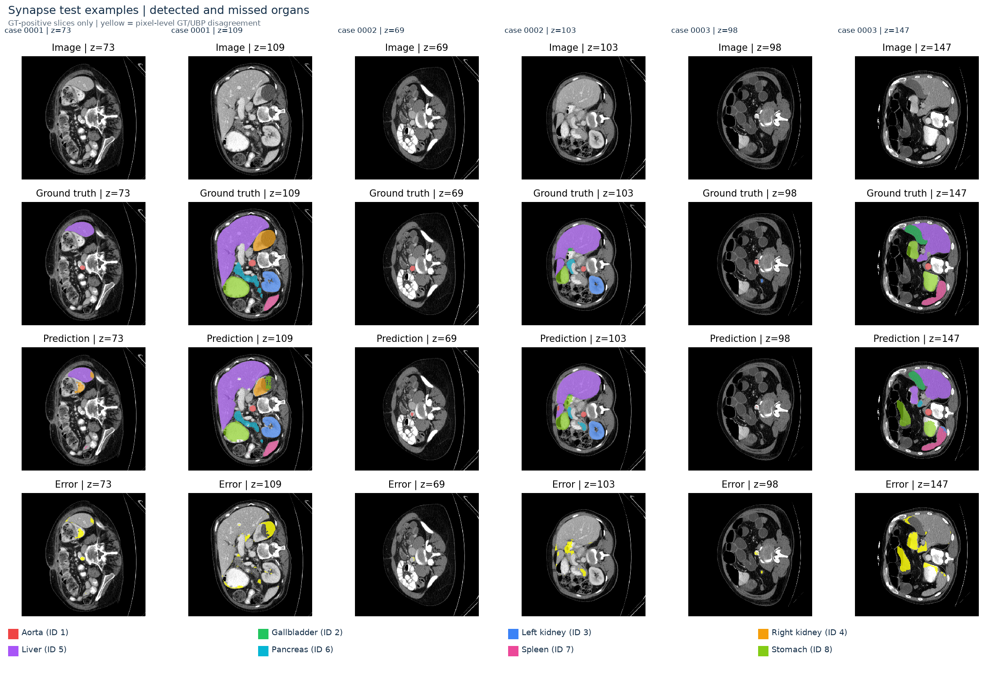

# UBP: Uncertainty-guided Boundary-selective Prototype refinement

**UBP (Uncertainty-guided Boundary-selective Prototype refinement)** is a lightweight prediction-guided refinement module for 2D medical image segmentation. This repository contains a reproducible implementation, fixed patient-level splits, training and evaluation commands, run-level metrics, and figures for ACDC and Synapse.

> **STATUS:** preliminary, these results are descriptive; they do not establish novelty or robust performance. HD95 is reported in voxel units because verified physical spacing is unavailable.

## Method

UBP refines a late decoder feature map using per-image prototypes built from reliable predicted regions. Pixels are selected when maximum class confidence is at least 0.7 and normalized entropy is at most 0.6. A local structural cue is compared with probability gradients; uncertainty and feature discrepancy produce a spatial gate. The learned correction is residual, with a scalar initialized to zero. A coarse prediction head receives auxiliary Dice plus cross-entropy supervision during training. Ground-truth labels are not used by the refinement at inference.

For feature tensor `F`, coarse probabilities `p`, gate `g`, and correction `Δ`, the update is `F′ = F + α · g · Δ(F, context(p,F), entropy(p), structure(F,p))`, with `α=0` initially. Unsupported class prototypes are masked. The confidence thresholds are implementation choices, not calibrated uncertainty estimates.



## UBP performance

Single-seed results (seed 1234, 300 epochs). Checkpoints were selected using validation cases held out from the training pool; supplied test cases were evaluated afterwards.

| Dataset | Test patients/cases | Mean Dice (patient bootstrap 95% CI) | Macro foreground HD95 (voxels) |
|---|---:|---:|---:|
| ACDC | 50 patients | 0.8914 (0.8834–0.8986) | 2.10 |
| Synapse | 12 cases | 0.7631 (0.7213–0.8039) | 35.32 |

### ACDC per-class test metrics

| ACDC structure | Dice | HD95 (voxels; valid / 100 volumes) |
|---|---:|---:|
| Right ventricle (ID 1) | 0.8707 | 3.36 (100/100) |
| Myocardium (ID 2) | 0.8723 | 1.14 (100/100) |
| Left ventricle (ID 3) | 0.9312 | 1.80 (100/100) |

### Synapse per-class test metrics

| Synapse structure | Dice | HD95 (voxels; valid / 12 cases) |
|---|---:|---:|
| Aorta (ID 1) | 0.8289 | 22.16 (12/12) |
| Gallbladder (ID 2) | 0.5339 | 13.98 (10/12) |
| Left kidney (ID 3) | 0.8252 | 45.56 (12/12) |
| Right kidney (ID 4) | 0.7740 | 83.39 (12/12) |
| Liver (ID 5) | 0.9288 | 24.98 (12/12) |
| Pancreas (ID 6) | 0.5780 | 13.26 (12/12) |
| Spleen (ID 7) | 0.8576 | 59.12 (12/12) |
| Stomach (ID 8) | 0.7782 | 20.13 (12/12) |

For Synapse class ID 2 (gallbladder), two HD95 outcomes are undefined (one missing prediction and one false-positive-only case); raw metrics retain these statuses and denominators.

### Compute profile

| Dataset | Parameters | Estimated FLOPs* | Batch-one median latency | Network throughput | Whole-volume evaluation throughput | Peak training VRAM | Training time |
|---|---:|---:|---:|---:|---:|---:|---:|
| ACDC | 40,644,493 | 15.980 G | 10.03 ms | 99.84 slices/s | 335.39 slices/s | 8.24 GiB | 67.7 min |
| Synapse | 40,644,141 | 15.903 G | 9.28 ms | 107.85 slices/s | 342.34 slices/s | 8.27 GiB | 69.4 min |

\*FLOPs are profiler estimates covering supported convolution and matrix operators only. Network latency is warmed-up batch-one inference; whole-volume throughput includes preprocessing and output restoration. Measurements came from shared GPUs and are descriptive snapshots.

### Qualitative test examples

These figures show only test slices with foreground in the ground truth, so the examples focus on detected and missed anatomy. Each column shows the image, ground truth, UBP prediction, and pixel-level disagreement; yellow marks any GT/prediction mismatch. Colors name the anatomical structures.

**ACDC — patient 101, frame 01:**



**Synapse — case 0001:**



Aggregate visualizations include [training curves](results/figures/training_curves.png), [ACDC per-structure test Dice](results/figures/acdc_per_class_dice.png), [Synapse per-organ test Dice](results/figures/synapse_per_class_dice.png), [patient split and empty-mask summary](results/figures/data_overview.png), and [Synapse organ imbalance](results/figures/synapse_class_imbalance.png). No dataset files or checkpoints are included.

## Data and protocol

Data are not bundled. Expected layout:

```text
data/
├── ACDC_preprocessed/
│   ├── ACDC_training_slices/
│   ├── ACDC_training_volumes/
│   └── ACDC_testing_volumes/
└── Synapse/
    ├── train_npz/
    └── test_vol_h5/
```

The fixed manifests in `splits/` use 90/10 training-pool patient separation for ACDC (90 train, 10 validation, 50 supplied test patients) and 15/3/12 cases for Synapse. The test partitions are disjoint and held until final evaluation. All valid training slices are retained, including 61/1,902 empty ACDC masks and 931/2,211 empty Synapse masks. Synapse validation volumes are assembled from the held-out patients' ordered training slices.

Inputs are resized to 224×224, images with cubic interpolation and labels with nearest-neighbor interpolation. The experiment preserves the stored image ranges: [0,1] for these MEDDATA copies. Use the same data version and preprocessing for a like-for-like rerun. The Synapse loader resizes/caches slices before stochastic augmentation; this order is part of the recorded experiment.

## Setup

Use Linux, Python 3.11+, an NVIDIA GPU, and a CUDA-enabled PyTorch build. Reference versions from the completed runs are in [`ENVIRONMENT.md`](ENVIRONMENT.md).

```bash
conda create -n ubp python=3.11 -y
conda activate ubp
# Install the PyTorch/CUDA build appropriate for your driver.
pip install -r requirements.txt
```

Place or edit `data_root` in the configs.  

## Train and evaluate

```bash
export CUDA_VISIBLE_DEVICES=0
python -B scripts/run_ubp.py \
  --config configs/ubp_synapse.json \
  --partition-manifest splits/synapse.json \
  --run-dir runs/synapse_ubp --mode smoke

python -B scripts/run_ubp.py \
  --config configs/ubp_synapse.json \
  --partition-manifest splits/synapse.json \
  --run-dir runs/synapse_ubp --mode train

python -B scripts/run_ubp.py \
  --config configs/ubp_synapse.json \
  --partition-manifest splits/synapse.json \
  --run-dir runs/synapse_ubp --mode evaluate --partition val

python -B scripts/run_ubp.py \
  --config configs/ubp_synapse.json \
  --partition-manifest splits/synapse.json \
  --run-dir runs/synapse_ubp --mode evaluate --partition test
```

For ACDC, use `configs/ubp_acdc.json` and `splits/acdc.json`. Configurations use batch size 24, AdamW, 300 epochs, FP32, and dataset-specific learning rates/loss weights recorded in JSON. Use a distinct run directory for every seed. The code checks patient overlap and verifies the selected checkpoint against its config and split.

## Rebuild reports and visualize arrays

```bash
python scripts/make_release_assets.py
python scripts/visualize_prediction.py \
  --image image.npy --label label.npy --prediction prediction.npy \
  --output figures/prediction.png
```

The first command regenerates result tables and summary figures from `results/raw/`. The second makes an image/ground-truth/prediction overlay from aligned 2D NumPy arrays.

## License and datasets

This project is released under the MIT License. The required license for the included model components is retained in [`model_components/LICENSE`](model_components/LICENSE). Obtain ACDC and Synapse separately and follow their dataset terms.
