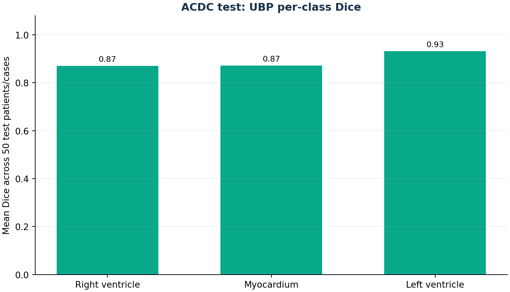
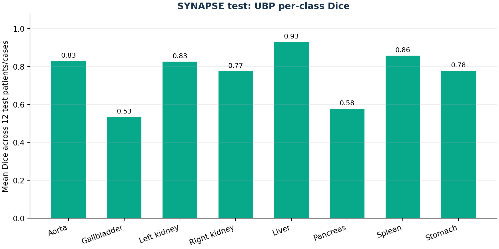
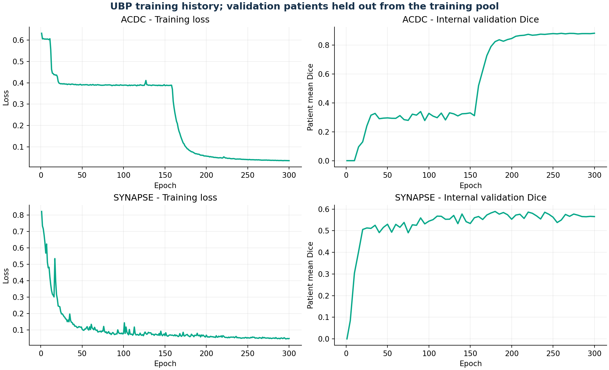

 <div align="center">

# 🩺 UBP
### Uncertainty-Guided Boundary-Selective Prototype Refinement

**Lightweight Prediction-Guided Refinement for Medical Image Segmentation**

[](https://www.python.org/)
[](https://pytorch.org/)
[](LICENSE)


**[Overview](#-overview) · [Architecture](#-architecture) · [Results](#-experimental-results) · [Installation](#-installation) · [Usage](#-quick-start) · [License](#-license)**

</div>

---

## 🔍 Overview

**UBP (Uncertainty-Guided Boundary-Selective Prototype Refinement)** is a lightweight, prediction-guided feature refinement module designed to improve anatomical segmentation by exploiting reliable class prototypes, structural cues, and uncertainty-aware spatial gating.

Rather than directly modifying segmentation masks, UBP operates on late-stage decoder features to produce a learned residual correction.

### ✨ Key Features

- 🎯 **Confidence-aware prototype selection** — Builds class prototypes from reliable predicted regions.
- 🧩 **Boundary-selective refinement** — Integrates structural information and probability gradients.
- 🛡️ **Uncertainty-guided gating** — Controls feature corrections using entropy and feature discrepancy.
- ⚡ **Residual integration** — Uses a learnable scaling parameter initialized to zero.
- 🔬 **Reproducible experiments** — Includes fixed patient-level splits, configurations, metrics, and visualizations.

> **Research status:** UBP is an experimental research prototype. The reported results are single-seed observations and do not independently establish novelty, statistical superiority, or robustness.

## 🏗️ Architecture

<div align="center">


*Overview of uncertainty-guided, boundary-selective prototype refinement.*

</div>

### How UBP Works

1. **Coarse prediction:** A lightweight prediction head estimates class probabilities from decoder features.
2. **Prototype construction:** Reliable predicted regions contribute to class-specific feature prototypes.
3. **Structural analysis:** Local structural cues are compared with probability gradients.
4. **Spatial gating:** Uncertainty and feature discrepancy determine where corrections are applied.
5. **Feature refinement:** A gated residual correction updates the decoder representation.

The refinement can be expressed as:

$$
F' = F + \alpha\, g\, \Delta(F, C, U, S)
$$

where:

- $F$ and $F'$ denote the original and refined features.
- $C$ represents prototype-based context.
- $U$ represents prediction uncertainty.
- $S$ represents structural information.
- $g$ is the learned spatial gate.
- $\alpha$ is a learnable residual scaling parameter initialized to zero.

Prototype selection uses a maximum confidence threshold of **0.7** and normalized entropy threshold of **0.6**. Unsupported class prototypes are masked. These thresholds are heuristic selection criteria, not calibrated uncertainty estimates.

An auxiliary coarse-prediction head receives Dice and cross-entropy supervision during training. Ground-truth labels are not used by the refinement module at inference.

## 📊 Experimental Results

UBP was evaluated on two public medical image segmentation benchmarks using fixed patient-level partitions.

### Quantitative Performance

| Dataset | Test Set | Mean Dice ↑ | HD95 ↓ |
|:---|:---:|:---:|:---:|
| **ACDC** | 50 patients | **89.14%** | **2.10** |
| **Synapse** | 12 cases | **76.31%** | **35.32** |

*HD95 is reported in voxel units because verified physical spacing was unavailable. Dice values are accompanied by patient/case-bootstrap 95% confidence intervals of 88.34–89.86% for ACDC and 72.13–80.39% for Synapse.*

**Evaluation protocol:** Single seed (1234), 300 training epochs, validation-based checkpoint selection, and final evaluation on held-out test partitions.

### 🫀 ACDC — Cardiac MRI Segmentation

<div align="center">


*Qualitative examples showing input images, ground truth, UBP predictions, and disagreement regions.*



</div>

### 🏥 Synapse — Multi-Organ CT Segmentation

<div align="center">


*Multi-organ segmentation examples with pixel-level prediction disagreements.*



</div>

### 📈 Training and Efficiency

<div align="center">



</div>

| Metric | ACDC | Synapse |
|:---|---:|---:|
| Parameters | 40.64 M | 40.64 M |
| Estimated FLOPs | 15.98 G | 15.90 G |
| Batch-1 latency | 10.03 ms | 9.28 ms |
| Peak training VRAM | 8.24 GiB | 8.27 GiB |
| Training time | 67.7 min | 69.4 min |

*FLOPs are partial operator estimates. Latency measurements were collected on shared GPUs and should not be interpreted as standardized hardware benchmarks.*

📑 **[Detailed Experimental Report](results/REPORT.md)** · **[Raw Metrics](results/raw/)** · **[Summary CSV](results/summary.csv)**

<details>
<summary><b>📋 View per-class segmentation results</b></summary>

#### ACDC

| Structure | Dice |
|---|---:|
| Right ventricle | 0.8707 |
| Myocardium | 0.8723 |
| Left ventricle | **0.9312** |

#### Synapse

| Structure | Dice |
|---|---:|
| Aorta | 0.8289 |
| Gallbladder | 0.5339 |
| Left kidney | 0.8252 |
| Right kidney | 0.7740 |
| Liver | **0.9288** |
| Pancreas | 0.5780 |
| Spleen | 0.8576 |
| Stomach | 0.7782 |

Detailed HD95 values, valid-case denominators, and undefined outcomes are retained in the experimental report and raw metric files.

</details>

## 🚀 Installation

### Requirements

- Linux
- Python 3.11+
- NVIDIA GPU with CUDA support
- CUDA-compatible PyTorch

```bash
git clone https://github.com/djene-mengistu/UBP.git
cd UBP

conda create -n ubp python=3.11 -y
conda activate ubp

# Install a compatible CUDA-enabled PyTorch build first.
pip install -r requirements.txt
```

See [ENVIRONMENT.md](ENVIRONMENT.md) for the reference software environment.

## 📂 Dataset Preparation

Download the ACDC and Synapse datasets separately and organize the preprocessed files as follows:

```text
data/
├── ACDC_preprocessed/
│   ├── ACDC_training_slices/
│   ├── ACDC_training_volumes/
│   └── ACDC_testing_volumes/
└── Synapse/
    ├── train_npz/
    └── test_vol_h5/
```

Update `data_root` in the corresponding configuration file.

| Dataset | Train | Validation | Test |
|---|---:|---:|---:|
| ACDC | 90 patients | 10 patients | 50 patients |
| Synapse | 15 cases | 3 cases | 12 cases |

Fixed split manifests are available in [`splits/`](splits/).

**Important:** Dataset files and pretrained checkpoints are not distributed with this repository.

## ⚙️ Quick Start

### 1. Smoke Test

```bash
python -B scripts/run_ubp.py \
  --config configs/ubp_synapse.json \
  --partition-manifest splits/synapse.json \
  --run-dir runs/synapse_ubp \
  --mode smoke
```

### 2. Train UBP

```bash
python -B scripts/run_ubp.py \
  --config configs/ubp_synapse.json \
  --partition-manifest splits/synapse.json \
  --run-dir runs/synapse_ubp \
  --mode train
```

### 3. Evaluate

Validation:

```bash
python -B scripts/run_ubp.py \
  --config configs/ubp_synapse.json \
  --partition-manifest splits/synapse.json \
  --run-dir runs/synapse_ubp \
  --mode evaluate \
  --partition val
```

Final test evaluation:

```bash
python -B scripts/run_ubp.py \
  --config configs/ubp_synapse.json \
  --partition-manifest splits/synapse.json \
  --run-dir runs/synapse_ubp \
  --mode evaluate \
  --partition test
```

For **ACDC**, replace the Synapse configuration and split manifest with:

- `configs/ubp_acdc.json`
- `splits/acdc.json`

Use a separate run directory for each dataset and random seed.

<details>
<summary><b>🔧 Additional utilities</b></summary>

Regenerate reports and result figures:

```bash
python scripts/make_release_assets.py
```

Visualize aligned NumPy arrays:

```bash
python scripts/visualize_prediction.py \
  --image image.npy \
  --label label.npy \
  --prediction prediction.npy \
  --output figures/prediction.png
```

The visualization utility supports input images, ground-truth labels, and predictions.

</details>

## 🗂️ Repository Structure

```text
UBP/
├── configs/             # Dataset-specific configurations
├── model_components/    # Backbone and model dependencies
├── results/
│   ├── figures/         # Architecture and visualizations
│   ├── raw/             # Run-level experimental metrics
│   └── REPORT.md        # Detailed experimental report
├── scripts/             # Training and visualization utilities
├── splits/              # Fixed patient-level partitions
├── src/medical_seg/     # UBP implementation
├── ENVIRONMENT.md       # Reference environment
├── requirements.txt
└── README.md
```

## 🔬 Reproducibility Notes

- Fixed patient-level train/validation/test partitions are used.
- All valid training slices are retained, including empty foreground masks.
- Input images and labels are resized to 224 × 224.
- Training uses AdamW, FP32, batch size 24, and 300 epochs.
- Checkpoints are selected using validation data.
- Dataset-specific learning rates and loss weights are defined in the configuration files.
- Physical voxel spacing is not verified; HD95 is therefore reported in voxel units.
- Single-seed results should not be interpreted as multi-run statistical evidence.

For exact preprocessing and evaluation details, consult the [experimental report](results/REPORT.md) and configuration files.

## 📜 License

This project is distributed under the [MIT License](LICENSE).

Licensing information for included third-party model components is preserved in [`model_components/LICENSE`](model_components/LICENSE).

ACDC and Synapse datasets must be obtained separately under their respective terms.

---

<div align="center">

**UBP — Uncertainty-Guided Refinement for Medical Image Segmentation**

⭐ If this repository is useful for your research, consider starring it.

[⬆ Back to Top](#-ubp)

</div>
